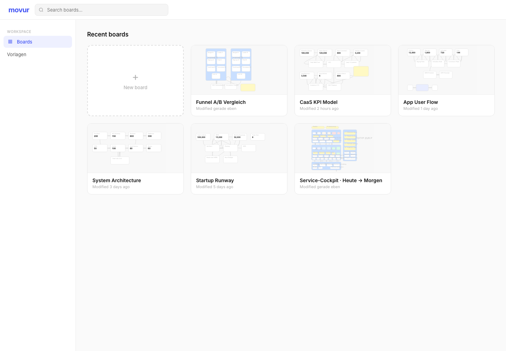
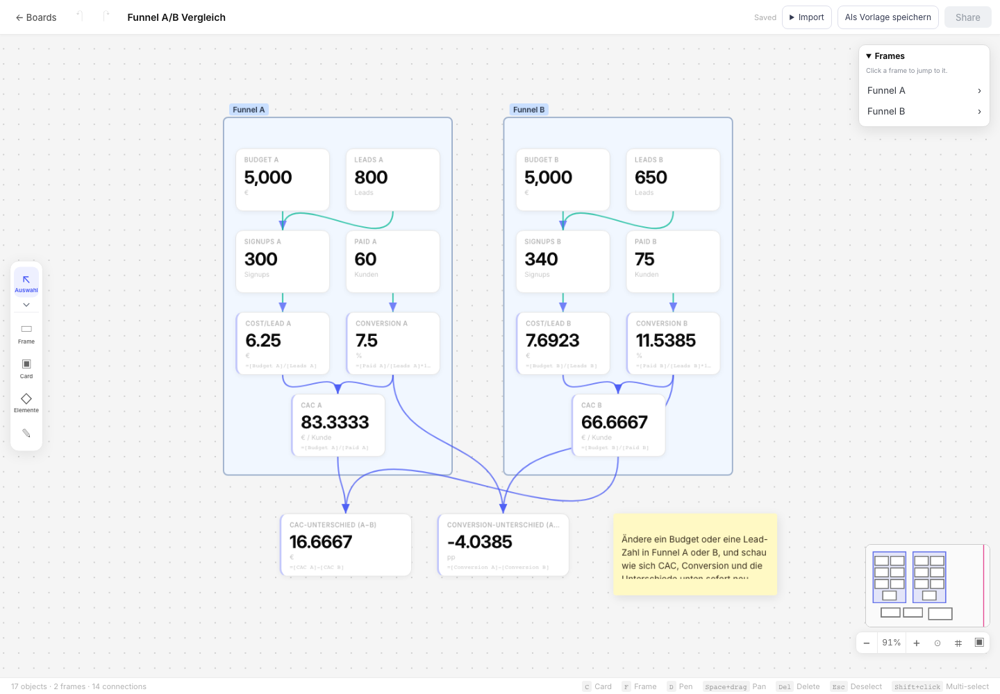

# movur: public showcase

**English** | [Deutsch](README.de.md)

**Think visually, calculate with data, and edit the connections.**

Assumptions, metrics, and decisions often end up scattered across whiteboards, spreadsheets, documents, and browser tabs. movur combines a freely organised board with typed data and calculations, keeping content and its relationships in one editable model.

## Who is it for?

Individuals and solo business owners as well as teams in small, medium-sized, and larger companies, particularly sales, marketing, product, support, and software development. Funnel and budget models, campaign planning, product roadmaps, and support workflows are use cases, not a claim of existing enterprise-system integrations.

## Status: implemented, local, and planned

**v0.1.0 is the prepared release target, not a published version demonstrated here.** This showcase is a curated technical view, not the complete application or evidence of deployment.

| Classification | Scope |
| --- | --- |
| Implemented in the documented editor | Boards, templates, cards with typed attributes and formulas, organising frames and a calendar view, connections, freehand drawing, selection, moving, resizing, and undo/redo. |
| Implemented data paths | Validated native board and Git-history JSON imports, files and images, and private account workspaces with server-side storage. Git import is not live synchronisation. |
| More recent local development, not evidenced by these images | Rich-text selection formatting, revised text input, unified formula input with board-reference selection, and date/date-range card attributes. This does not establish publication. |
| v1.0.0 target, not yet a shipped AI product feature | Text, voice, and structured data turned into editable boards; controlled AI changes and traceable sources. See the [AI roadmap, in German](docs/AI_ROADMAP.md). |

No full Excel or BPMN compatibility, real-time collaboration, or generally available CRM or AI-provider connectors. File or CSV/TSV previews are not complete structured business-data imports. Including larger companies as a target audience does not establish enterprise readiness, compliance, or scalability approval.

## Real application, synthetic data



A board overview showing synthetic example content.



A funnel A/B comparison in the editable board.

The images come from an older, actually rendered local build, not a design mockup or a current production deployment. The application UI remains in its original language. [Image provenance and limitations, in German](docs/screenshots/README.md).

## Technology and selected original excerpts

React, TypeScript, and Vite; a custom editor and formula engine; Clerk for sign-in; Cloudflare Pages/Functions and D1 for account workspaces. The [architecture documentation, in German](docs/ARCHITECTURE.md) describes responsibilities and data flow.

Two small, unchanged TypeScript files illustrate URL metadata and image-data validation. They are **proprietary original excerpts for inspection and technical evaluation**, not an open-source SDK, a complete import pipeline, or a runnable application. [Components and code provenance, in German](components/README.md).

### Check the excerpts

Requires Node.js 22.18 or later, with no external packages or credentials:

```bash
npm test
```

The eight tests check the pure URL/image-format helpers, including invalid inputs and the limits of format validation. They do not replace browser testing of FileReader or testing of the complete application.

## Rights, trust, and business model

- [LICENSE](LICENSE): original text, images, and components remain proprietary; no MIT or CC licence.
- [Business model, in German](docs/BUSINESS_MODEL.md): a free public beta is the target, including for individuals; later monetisation remains open.
- [Security and trust model, in German](docs/SECURITY.md).
- [SHA-256 file manifest](MANIFEST.sha256).

The main product remains private. This standalone showcase contains neither the complete application code nor the private repository history or operational configuration. The showcase is publicly available at **[yannikberner-AI-PM/movur-showcase](https://github.com/yannikberner-AI-PM/movur-showcase)**; its default branch is **main**. Publishing this repository does not constitute production approval for the movur application.

Contact: info@movur.app.
