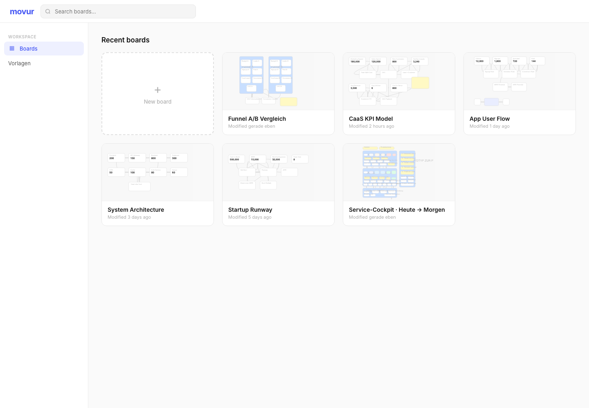
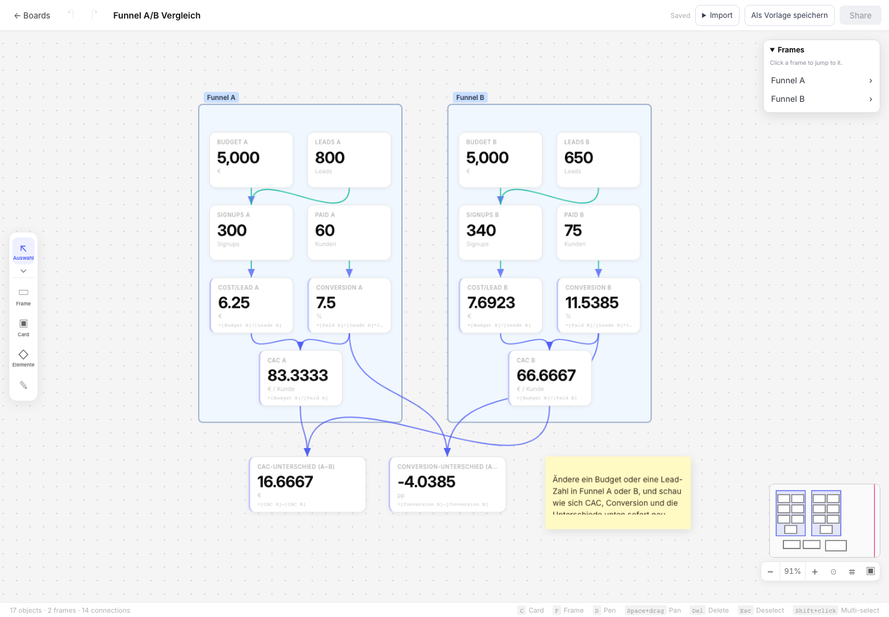

# movur — öffentliches Showcase

**Visuell denken, mit Daten rechnen, Zusammenhänge bearbeiten.**

Annahmen, Kennzahlen und Entscheidungen verteilen sich oft auf Whiteboards, Tabellen, Dokumente und Browser-Tabs. movur verbindet ein frei organisierbares Board mit typisierten Daten und Berechnungen: Inhalte und Zusammenhänge bleiben in einem bearbeitbaren Modell.

## Für wen?

Für Privatnutzer, Einzelpersonen und Solo-Selbstständige ebenso wie für Teams in KMU und größeren Unternehmen — insbesondere Sales, Marketing, Product, Support und Softwareentwicklung. Funnel- und Budgetmodelle, Kampagnenplanung, Produkt-Roadmaps und Supportabläufe sind Anwendungsfelder, keine Zusage bereits integrierter Unternehmenssysteme.

## Status: vorhanden, lokal und geplant

**v0.1.0 ist das vorbereitete Release-Ziel, kein hier nachgewiesener veröffentlichter Versionsstand.** Dieses Showcase ist eine kuratierte technische Ansicht, nicht die vollständige Anwendung und kein Deployment-Nachweis.

| Einordnung | Umfang |
| --- | --- |
| Im dokumentierten Editor implementiert | Boards, Vorlagen, Cards mit typisierten Attributen/Formeln, strukturierende Frames und Kalenderdarstellung, Verbindungen, Freihand, Auswahl, Verschieben, Größenänderung und Undo/Redo. |
| Implementierte Datenwege | Validierte native Board- und Git-Historien-JSON-Importe, Dateien/Bilder, private Account-Workspaces mit serverseitigem Speichern. Git-Import ist keine Live-Synchronisierung. |
| Neuere lokale Entwicklung, nicht in den Bildern belegt | Rich-Text-Auswahlformatierung, überarbeitete Texteingabe, einheitliche Formeleingabe mit Board-Referenzauswahl sowie Datum/Zeitraum als Kartenattribute. Daraus folgt keine Veröffentlichung. |
| Ziel v1.0.0, noch keine ausgelieferte KI-Produktfunktion | Text, Sprache und strukturierte Daten zu editierbaren Boards; kontrollierte KI-Änderungen und nachvollziehbare Quellen. Siehe [KI-Roadmap](docs/AI_ROADMAP.md). |

Keine vollständige Excel-/BPMN-Kompatibilität, keine Echtzeit-Zusammenarbeit und keine allgemein verfügbaren CRM-/KI-Provider-Connectoren. Datei- oder CSV/TSV-Vorschauen sind keine vollständigen strukturierten Geschäftsimporte. Corporate als Zielgruppe bedeutet keine Enterprise-, Compliance- oder Skalierungsfreigabe.

## Echte Anwendung, synthetische Daten





Die Bilder stammen aus einem tatsächlich gerenderten älteren lokalen Build, nicht aus einem Design-Mockup und nicht aus einem aktuellen Produktivdeployment. [Bildherkunft und Grenzen](docs/screenshots/README.md).

## Technik und ausgewählte Originalauszüge

React, TypeScript und Vite; eigener Editor und eigene Formelengine; Clerk für Anmeldung, Cloudflare Pages/Functions und D1 für Account-Workspaces. [Architektur](docs/ARCHITECTURE.md) beschreibt Zuständigkeiten und Datenfluss.

Zwei kleine, unveränderte TypeScript-Dateien illustrieren URL-Metadaten und Bilddatenvalidierung. Sie sind **proprietäre Originalauszüge zur Ansicht und technischen Bewertung**, kein Open-Source-SDK, keine vollständige Importpipeline und keine lauffähige Anwendung. [Komponenten und Codeherkunft](components/README.md).

### Auszüge prüfen

Mit Node.js ab 22.18, ohne externe Pakete oder Zugangsdaten:

```bash
npm test
```

Die acht Tests prüfen die reinen URL-/Bildformat-Hilfsfunktionen, einschließlich ungültiger Eingaben und der Grenzen einer Formatprüfung. Sie ersetzen keine Browserprüfung von FileReader oder einen Test der vollständigen Anwendung.

## Rechte, Vertrauen und Geschäftsmodell

- [LICENSE](LICENSE): eigene Texte, Bilder und Komponenten bleiben proprietär; keine MIT-/CC-Lizenz.
- [Geschäftsmodell](docs/BUSINESS_MODEL.md): kostenlose öffentliche Beta als Ziel, auch für Privatnutzer; spätere Monetarisierung offen.
- [Sicherheits- und Vertrauensmodell](docs/SECURITY.md).
- [SHA-256-Dateimanifest](MANIFEST.sha256).

Das Hauptprodukt bleibt privat. Dieses eigenständige Showcase enthält weder vollständigen Anwendungscode noch Repository-Historie oder Betriebskonfiguration. Vorgesehener öffentlicher Repositoryname: **yannikberner-AI-PM/movur-showcase**; diese Dokumentation behauptet keine erfolgte Veröffentlichung.

Kontakt: info@movur.app.
